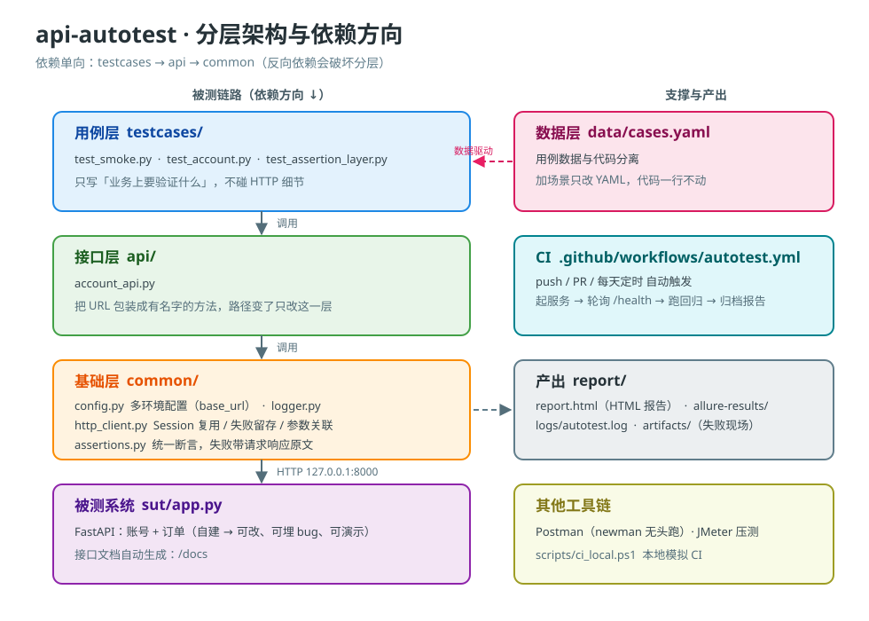

# api-autotest

[](https://github.com/yizi2333/api-autotest/actions/workflows/autotest.yml)

> 基于 **pytest + requests** 的账号与订单系统接口自动化测试框架。
> 被测系统也是本仓库自带的（FastAPI），clone 下来就能跑。

<!-- ★ 待填（D8）：这里写 2–3 句，回答三个问题：
     ① 为什么做这个项目？（不是"为了学习"—— 说清楚你被什么重复劳动烦到了）
     ② 它解决什么问题？
     ③ 现在到什么程度了？（多少用例 / 覆盖哪些模块 / 回归多久）
-->

---

## 快速开始

```bash
# 1) 装依赖
python -m venv .venv
.venv\Scripts\activate          # Windows；Linux/macOS 用 source .venv/bin/activate
pip install -r requirements.txt

# 2) 起被测系统（另开一个终端）
uvicorn sut.app:app --port 8000 --reload
# 接口文档：http://127.0.0.1:8000/docs

# 3) 跑测试
pytest                          # 全量
pytest -m smoke                 # 只跑冒烟
pytest -m negative              # 只跑异常场景
pytest testcases/test_account.py -v
```

报告产物：
- `report/report.html` —— HTML 报告，浏览器直接打开
- `report/allure-results/` —— Allure 原始结果（装了 allure CLI 可生成更漂亮的报告）
- `report/logs/autotest.log` —— 详细日志
- `report/artifacts/` —— 失败时留存的请求/响应原文

---

## 架构



依赖方向是**单向**的：`testcases → api → common`。反向依赖会破坏分层。

| 层 | 文件 | 职责 |
|---|---|---|
| 数据层 | `data/cases.yaml` | 用例数据。加场景只改这里 |
| 基础层 | `common/config.py` | 多环境配置（`base_url` 等） |
| | `common/http_client.py` | 请求封装、Session 复用、失败留存 |
| | `common/assertions.py` | 统一断言，失败信息带请求/响应原文 |
| | `common/logger.py` | 日志 |
| | `common/dataprovider.py` | YAML 加载 + 占位符替换 |
| 接口层 | `api/account_api.py` | 账号接口定义 |
| 用例层 | `testcases/` | 测试用例与断言 |
| 被测系统 | `sut/app.py` | FastAPI 实现（账号 + 订单） |

<!-- ★ 待填（D8）：上面这张图是打样。
     面试官一定会让你**现场画**这个图 —— 所以你要能不看图默画出来，
     并且每画一层就说清它的职责、和上下层谁调用谁。
     如果你后面调整了分层（比如拆出 service 层），记得同步更新 docs/architecture.svg。 -->

---

## 设计取舍

<!-- ★ 待填（D8）：这一节是**最值钱**的。面试官看的就是这里。
     下面每个问题都写出你的真实理由，不要写"业界惯例"。
     写不出理由的设计，就是还没想清楚的设计。 -->

**Q：为什么用 YAML 而不是 Excel 做数据驱动？**

<!-- 待填 -->

**Q：为什么用 `requests.Session()` 而不是每次 `requests.get()`？**

<!-- 待填 提示：想两个原因，一个是性能，一个是功能 -->

**Q：为什么 HTTP 客户端里**不**调 `raise_for_status()`？**

<!-- 待填 提示：想想"返回 401"对某些用例意味着什么 -->

**Q：为什么不用固定的用户名，而要加随机后缀？**

<!-- 待填 -->

**Q：这个方案有什么缺陷？重做会怎么改？**

<!-- 待填 ★ 这题一定要写出一个真实缺陷。答"没什么缺陷"是最差答案。 -->

---

## 踩坑记录

## 踩坑记录

> 这一节是整个 README 里最有说服力的一节 —— **因为编不出来**。
> 格式：【现象】→【我以为是】→【实际是】→【怎么修的】

### 坑 1：边界值用例加了随机后缀，长度就不是我以为的那个了

- **现象**：`REG-001`「用户名 2 位，低于下界 3」期望被拒绝（422），实际返回 **201 注册成功**
- **我以为是**：被测系统的长度校验写错了
- **实际是**：用例数据写的是 `"ab{suffix}"`，运行时替换成 `"ab"` + 8 位十六进制 = **10 个字符**
  —— 这条用例**压根没测到"低于下界"**，它测的是一个 10 位的合法用户名
- **怎么修的**：边界值用例不加后缀；"可重复执行"改用 `conftest.py` 里的 `clean_db`
  fixture（每次运行前清库）来保证
- **★ 教训**：数据和代码之间隔着**一层替换**，结论就不是你以为的那个了。
  这和我另一个仓库记的「静默失效」是同一类问题：**不报错，但结果不对**

### 坑 2：两条用例抢同一个账号

- **现象**：`test_register_then_login` **单独跑是绿的**，全量跑报 409 用户名已存在
- **我以为是**：pytest 的执行顺序有问题
- **实际是**：它和 `logged_in_user` fixture 共用了同一个 `test_user`，而 fixture 已经先注册过了
- **怎么修的**：这条用例自己造唯一用户，不复用共享 fixture
- **★ 教训**：「**单独跑绿、一起跑红**」是测试数据污染的典型症状 ——
  遇到这个症状，第一反应应该是查共享状态，而不是查被测系统

- **★ 教训**：「**单独跑绿、一起跑红**」是测试数据污染的典型症状 ——
  遇到这个症状，第一反应应该是查共享状态，而不是查被测系统

### 坑 3：`ci_local.ps1` 在 Windows PowerShell 5.1 下直接解析失败

- **现象**：脚本报 `The string is missing the terminator`，报错信息里的中文全是乱码（`鎶ュ憡` 之类）
- **我以为是**：脚本语法写错了（比如少了个引号或花括号）
- **实际是**：文件存的是 **UTF-8 无 BOM**，而 **Windows PowerShell 5.1 默认按 GBK 读 `.ps1`** ——
  中文被读成乱码，乱码字节又破坏了字符串的字面量边界，于是报成"语法错误"
- **怎么修的**：把 `.ps1` 存成 **UTF-8 带 BOM**（`EF BB BF`）。5.1 看到 BOM 才会按 UTF-8 解析
- **★ 教训**：**报错信息指向的位置，往往不是问题所在。**
  "语法错误"的第一反应应该是查**编码**，而不是去数括号 ——
  因为语法分析器读到的字节，已经不是你以为的那份内容了

### 坑 4：为了"本机能跑"写死解释器路径，结果掩盖了真正的问题

- **现象**：`ci_local.ps1` 里写死了 `D:\Code\security-lab\.venv\Scripts\python.exe` 作为兜底。
  删掉它改成自动查找后，脚本选到了 PATH 里的全局 Python → 起不来服务 → 报「30 秒内未就绪」
- **我以为是**：查找 Python 的候选列表写错了
- **实际是**：**两件事都不对**：
  ① 写死绝对路径 → 别人 clone 下来路径不存在，脚本必挂；
  ② 兜底到 PATH 里的 `python` → 可能是另一个版本，**没装项目依赖**
- **怎么修的**：候选列表（环境变量 → 项目 venv → PATH）+ **提前 import 一次做依赖校验**，
  缺依赖就给出可操作的报错，而不是等 30 秒说"服务未就绪"
- **★ 教训**：**「本机能跑」不等于「别人能跑」。**
  而且更阴的是 —— 写死的路径会**掩盖**问题：它让脚本在这台机器上"恰好"能跑，
  于是你永远不会想到别人跑不起来。**能跑的原因和能跑这件事，是两回事。**

### 坑 5：错误处理代码自己就是坏的

- **现象**：上面那个依赖校验写好之后，真正缺依赖时**友好报错没打出来**，
  屏幕上只有一段 `NativeCommandError` 堆栈
- **我以为是**：`Write-Host` 的中文编码又出问题了
- **实际是**：脚本开头设了 `$ErrorActionPreference = "Stop"`。
  在这个模式下，**原生命令往 stderr 写任何东西都会被当成终止错误** ——
  于是校验那一行直接把脚本中断了，**报错代码自己先死了**
- **怎么修的**：调用前后临时把 `$ErrorActionPreference` 切回 `Continue`，手动读 `$LASTEXITCODE`
- **★ 教训**：**错误处理代码本身也需要被测试。**
  我写完那段"友好提示"之后一次都没触发过它 ——
  直到真的制造了一个缺依赖的环境，才发现它根本跑不到。
  **没被触发过的代码 = 没写过的代码。**

<!-- ★ 待填（D8）：补上你自己踩的坑。
     你在写订单模块、加断言、调 CI 的时候一定会遇到。
     遇到就记下来：【现象】→【我以为是】→【实际是】→【怎么修的】
-->

---

## 质量意识

> 这个框架的断言设计原则，来自我在另一个仓库记录的 **12 个「静默失效」**案例
> —— 那些**不报错、不崩溃、但返回错误结果**的 bug。
>
> 结论：**断言不能只校验「请求是否成功」，必须同时校验「数据是否符合预期」。**
>
> 详见：https://github.com/yizi2333/web-security-lab

---

## CI

`.github/workflows/autotest.yml`：

```
push / PR / 每天定时
   ↓ 拉代码 → 装依赖
   ↓ 起被测系统 + 轮询 /health 等就绪
   ↓ pytest（全量）
   ↓ 上传报告（用例挂了也上传）
```

---

## 测试工具链

同一套被测系统，用三种工具各跑一遍 —— 这不是重复劳动，而是回答「**什么时候该用哪个**」。

| 工具 | 位置 | 用途 | 验证状态 |
|---|---|---|---|
| **pytest + requests** | `testcases/` | 主力回归：分层、数据驱动、可进 CI | ✅ 13 passed |
| **Postman / newman** | `postman/` | 手工调试 + 接口文档；`newman` 可无头跑进 CI | ✅ 5 请求 / 13 断言全过 |
| **JMeter** | `perf/` | 性能压测：并发、吞吐、P95 | ✅ 220 采样 / 108 req/s / 错误率 0% |

**三者的分工（面试常问）：**

- **Postman** —— 探索阶段。接口刚写好，你想快速试一发、看看返回长什么样。
  它的强项是「所见即所得」，弱项是**用例一多就难维护**。
- **pytest** —— 沉淀阶段。用例要长期跑、要进 CI、要能重构，就得用代码。
- **JMeter** —— 专项阶段。你要回答的不是「功能对不对」，而是「**多少并发会崩**」。

> ★ 三个工具都会，而且都能说出**取舍理由**，比只会一个但说不出为什么强得多。

### 跑法

```bash
# Postman 集合（无头）
newman run postman/api-autotest.postman_collection.json -e postman/local.postman_environment.json

# JMeter 压测
jmeter -n -t perf/api-load.jmx -l perf/results.jtl -e -o perf/report
```

详见 [`perf/README.md`](perf/README.md)。

---

## 待办

- [ ] 订单模块（`sut/app.py` 里的 TODO）
- [ ] 订单接口用例，含**水平越权**场景
- [ ] 数据库落库校验断言
- [ ] 失败自动重试（只对网络类失败重试，业务失败不重试）
- [ ] 并发执行（pytest-xdist）
